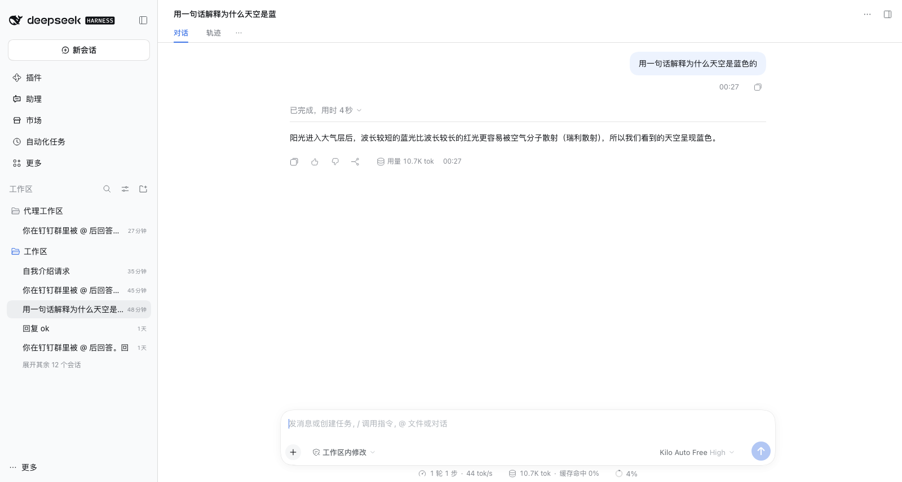

<div align="center">

# Colony

**Turn an AI agent into team infrastructure.**

One isolated instance per team. `@` it in DingTalk / Feishu. Accounts, access control,
sleep-wake, backups and a skill marketplace — all on your own machines.

[](LICENSE)
[](https://nodejs.org)
[](#quickstart)

[中文](README.md) · [Docs](docs/features/README.md) · [Contributing](CONTRIBUTING.md)

</div>



## What it is

In one sentence: **deploy one agent to the cloud, share it with the whole team, extend it with plugins.**

[DeepSeek Harness](https://github.com/deepseek-ai/deepseek-harness) (dsh) is built for one person — one process,
one session, one `$DSH_HOME`. That is great solo and breaks down for a team: anyone can walk in, sessions bleed
into each other, nobody dares restart the box, and it burns RAM while idle. This project fills that gap:

- **One team = one agent instance** (a compose project / a Helm release), isolated volumes, no cross-team bleed.
- **Many people share that one agent**, each with an account and a role, with an audit trail.
- **Plugin-based extension** — capabilities ship as npm packages installed into the profile; `apply(ctx)` runs
  inside the dsh process, and `make reload` swaps them in about ten seconds.
- **The agent lives in your chat, too.** `@` the bot in DingTalk / Feishu; the reply lands in that group,
  same session. DingTalk uses a **Stream** long connection, so no public IP and no tunnel required.
- **Sleep when idle, wake on access**; several teams fit on one box.
- **Sessions survive restarts** — sessions and archives go to a content-addressed object layer, so the container
  is a disposable cache.

It is *not* another chat front-end. It is the operations layer: how images ship, how teams are provisioned,
how model keys are stored, how data outlives a `docker rm`.

### Two repositories

| Repo | Contains | For |
| --- | --- | --- |
| **this one** (platform) | image, profile, control plane, account service, assistants, market — plus the six plugins | running the team edition with one command |
| [colony-dsh-plugins](https://github.com/cookie-zl/colony-dsh-plugins) | just the six plugin packages | you already run dsh and only want, say, `workspace-guard` |

The dependency is one-way: the plugin repo does not know the platform exists. Plugins are still developed and
tested here (their behaviour tests need a dsh container and DB fixtures), then exported with
`make mirror-plugins`, with `make mirror-check` guarding against drift.

No git submodules on purpose: private submodules need extra credentials, and a `git clone` without
`--recurse-submodules` yields a build that fails — the classic open-source turn-off.

## Quickstart

Requires Docker and `make`.

```bash
git clone https://github.com/cookie-zl/colony.git && cd colony
make seed      # generate accounts.json / nodes.json / .env (demo login admin / demo1234)
make up        # build image, start team-a → http://team-a.localhost:8080/
```

A model key is optional — the default lane is a free model. To bring your own:

```bash
make team-key TEAM=team-a KEY=sk-xxx   # encrypted at rest, never visible inside the container
```

`make help` lists every target; `make reload` swaps in plugin changes in ~10s.

## Architecture

```mermaid
flowchart TB
  B[Browser] -->|cookie / login| EDGE[Edge proxy<br/>session → membership → dsh token]
  G[DingTalk / Feishu] -->|@bot| STREAM[Stream connection<br/>or HTTP callback]
  EDGE --> AUTH[Account service]
  EDGE -->|reverse proxy| DSH[Team instance<br/>dsh + plugins]
  STREAM --> CONSOLE[Control plane<br/>provision · quota · sleep/wake · assistant dispatch]
  CONSOLE -->|docker / k8s| DSH
  AUTH --> DB[(Fact DB<br/>teams · skills · secrets · messages)]
  CONSOLE --> DB
  DSH --> OBJ[(Object layer<br/>sessions · archives · artifacts)]
```

## Honest limitations

1. **Stateful, single replica.** dsh keeps sessions in memory + `$DSH_HOME`, so `replicas: 1`,
   `ReadWriteOnce`, and `Recreate` on upgrade. Scale by adding instances, not replicas.
2. **Plugins are in-process code, not a sandbox.** `apply(ctx)` runs with dsh's own privileges.
   Installing a community plugin means trusting its author with code execution — `plugins.txt` pins exact versions.
3. **One auth layer, outside dsh.** dsh identifies visitors by "token in URL → signed cookie".
   Real access control belongs in the proxy / gateway (see [docs/06](docs/06-访问控制.md)).
4. **Maturity: production-own-use, not 1.0.** Single maintainer, interfaces will move.
   DingTalk is verified end-to-end; Feishu uses an HTTP callback and needs a public endpoint.
5. **Only `@`-mentions are processed.** Full group message access is a sensitive scope on both platforms.

## Docs

- Design notes (why, and what broke): [`docs/01`–`docs/20`](docs/features/README.md)
- Feature inventory (what exists, where, and how it was verified): [`docs/features/`](docs/features/README.md)
- Roadmap, known gaps and things we deliberately did **not** build: [`docs/ROADMAP.md`](docs/ROADMAP.md)

Chinese is the primary documentation language; English translations are welcome.

## License

[Apache-2.0](LICENSE). dsh itself is not vendored here — it is pinned as an npm dependency under its own license.
