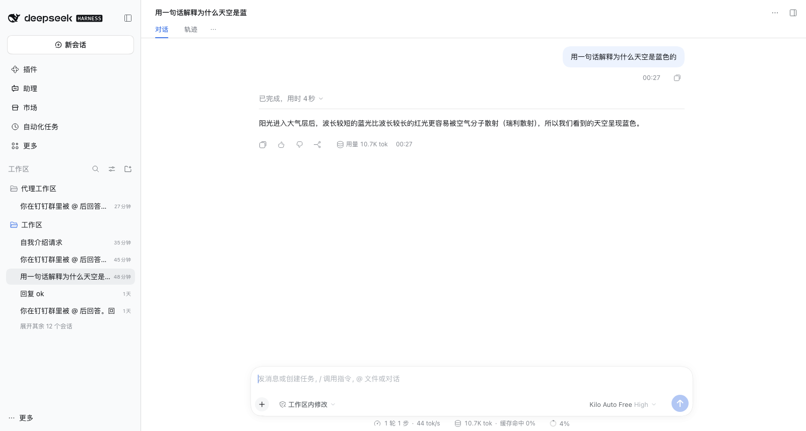
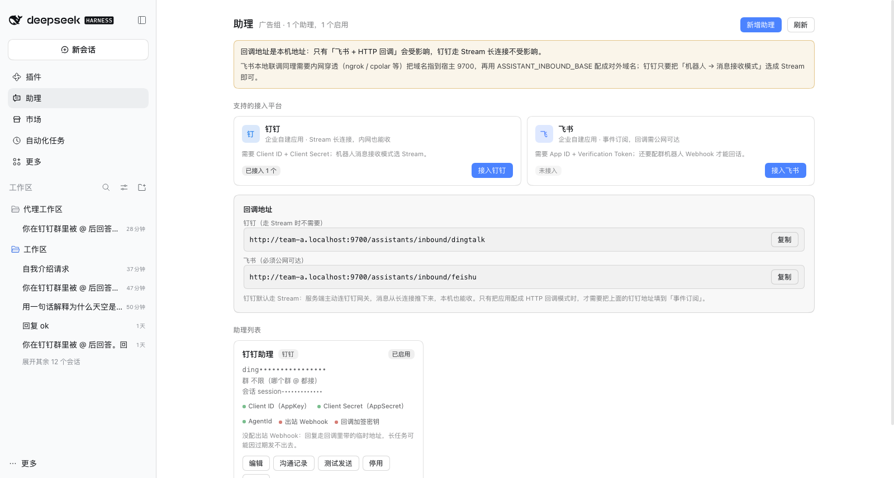

<div align="center">

# Colony

**把 AI Agent 变成团队基础设施**

一个团队一个隔离实例，在钉钉 / 飞书群里 `@` 一下就能干活；
账号、准入、休眠、备份、技能市场全都在你自己的机器上。

[](LICENSE)
[](https://nodejs.org)
[](deploy/)
[](#快速开始)
[](CONTRIBUTING.md)

</div>



---

## 这是什么

一句话：**把一个 Agent 部署到云上，让整个团队共用它，再用插件往里加能力。**

dsh 本身是单人视角的：一个进程、一份会话、一个 `$DSH_HOME`。一个人用很顺手，给团队用就会撞墙——
谁都能进、会话互相污染、机器不敢重启、闲置还在烧钱。本项目补的就是这一层：

- **一个团队 = 一个 Agent 实例**（一个 compose 项目 / 一个 Helm release），卷隔离、上下文不串味；
- **多个人共用同一个 Agent**，各有账号与角色，谁做了什么有审计；
- **插件化扩展**：能力以 npm 包形态装进 profile，`apply(ctx)` 跑在 dsh 进程内，改完 `make reload` 十秒生效；
- **Agent 不止活在网页里**：钉钉 / 飞书群里 `@` 它，回复回到那个群，上下文还是同一个；
- 闲置自动休眠、访问自动唤醒，一台机器塞得下好几个团队。

它不是又一个聊天前端，而是**一层运营系统**：镜像怎么发、团队怎么建、密钥怎么管、数据怎么活过重启。

### 两个仓库

| 仓库 | 放什么 | 给谁用 |
| --- | --- | --- |
| **本仓**（平台） | 镜像、profile、控制面、账号服务、助理、市场，**外加 6 个自研插件** | 想「一条命令把团队版 Agent 跑起来」 |
| [colony-dsh-plugins](https://github.com/cookie-zl/colony-dsh-plugins) | 只有那 6 个插件包 | 已经有 dsh，只想装 `workspace-guard` / `changes-collector` |

依赖是单向的：**插件仓不需要知道平台存在**，`dsh plugin add <目录>` 就能用；
插件仍然在本仓开发和验证（行为测试要 dsh 容器与数据库夹具），
用 `make mirror-plugins` 导出到插件仓，`make mirror-check` 在 CI 里防漂移。

不用 git submodule 是刻意的：私有仓的 submodule 要额外配凭据，`git clone` 忘了 `--recurse-submodules`
就构建失败——这是开源项目最常见的劝退点。

---

## 为什么需要它

如果你只是自己用，`npx` 跑一个 Agent 就够了。**一旦要给一个团队用**，会同时撞上四堵墙：

| 你遇到的问题 | 裸跑一个 Agent 的做法 | Colony 的做法 |
| --- | --- | --- |
| 多人共用一个会话 | 上下文互相污染，A 的代码进 B 的回答 | 一个团队一个实例，卷隔离；助理再按「群 / 单聊」拆成独立会话窗口 |
| 没有账号体系 | 谁拿到 URL 谁就能用，删库也没人知道是谁 | 账号服务 + 团队角色 + 审计日志；dsh 自己的 token 关在反代后面 |
| 内网进不来 / 出不去 | 飞书要公网回调，钉钉要各种地址 | 钉钉走 **Stream 长连接**：内网机器主动外连，不用公网 IP、不用内网穿透 |
| 闲置也在烧钱 | 常驻容器，夜里没人用也占着内存 | 闲置 30 分钟自动停，访问时自动拉起（冷启约 9s，见 [docs/09](docs/09-休眠与唤醒.md)） |

还有两个更隐蔽的：**会话丢了就真没了**（容器一重建全没）、**装一个插件等于让它在你服务器上跑代码**。
这两件都在本项目里有明确答案，见 [会话存算分离](docs/15-会话存算分离.md)、[社区插件审计](docs/03-社区插件.md)。

---

## 能力一览

| 能力 | 一句话 | 入口 |
| --- | --- | --- |
| **多团队、一团队一实例** | 一个 compose 项目 / Helm release 一个团队，主机名、端口、卷全独立 | `deploy/compose/team-up.sh`·[docs/07](docs/07-多团队账号.md) |
| **账号与准入** | 登录、改密、团队角色、加入团队、跨团队票据、访问审计 | `deploy/auth/`·[docs/07](docs/07-多团队账号.md) |
| **控制面** | 点一下门户按钮 = 建一个容器；配额校验、失败回滚、容器对账 | `deploy/orchestrator/console.mjs`·[docs/08](docs/08-动态建团队.md) |
| **休眠与唤醒** | 四条判据判断闲置，访问即拉起；唤醒态对用户透明 | `runtime.mjs`·[docs/09](docs/09-休眠与唤醒.md) |
| **IM 助理** | 钉钉 / 飞书 `@` 机器人 → 同一个 Agent 会话 → 回原群；支持一机器人多窗口 + 每窗口专属提示词 | `assistants.mjs`·[docs/features/11](docs/features/11-助理与消息机器人.md) |
| **技能 / 连接器市场** | 包 + 索引 + 安装台账，按团队隔离；支持点对点分享 | `deploy/market/`·[docs/11](docs/11-技能与连接器.md) |
| **密钥网关** | 模型 Key 信封加密进库，容器只拿可吊销的短令牌，不落明文 | `llm-gateway.mjs`·[docs/18](docs/18-密钥网关.md) |
| **产物归因** | 每轮对话改了哪些文件、产出在哪，可查可追 | `changes-collector`·[docs/20](docs/20-产物归因与配置热生效.md) |
| **会话存算分离** | 会话与归档进对象层（内容寻址），容器是可丢的缓存 | `objects.mjs`·[docs/14](docs/14-对象层.md)·[docs/15](docs/15-会话存算分离.md) |
| **可观测** | `/metrics` 暴露团队数、唤醒时长、配额占用，直接喂 Prometheus | `metrics.mjs`·[docs/10](docs/10-平台运维.md) |

自研插件 6 个，全部是纯 ESM、无构建步骤的进程内 bundle：`workspace-guard`、`changes-collector`、
`market-skill`、`client-ui-market`、`client-ui-assistants`、`hello-dsh`（样板）。

### 群里的样子



一条完整链路（真机验证过，不是设计稿）：

```
群里 @机器人
  → 钉钉经 Stream 长连接推一帧事件（不需要公网回调）
  → 控制面归一化 → 消息流水落库（msgId 去重）
  → docker exec dsh --profile headless（该助理 / 该群固定 session）
  → OpenAPI 主动发送回原群（不依赖 1.5 小时就过期的 sessionWebhook）
```

细节、失败兜底、踩过的坑：[docs/features/11](docs/features/11-助理与消息机器人.md)。

---

## 快速开始

需要 Docker（macOS / Linux 都行），以及 `make`。

```bash
git clone https://github.com/cookie-zl/colony.git && cd colony

make seed      # 生成 accounts.json / nodes.json / .env（演示账号 admin / demo1234）
make up        # 构建镜像并起 team-a → http://team-a.localhost:8080/
```

首次构建要装依赖，几分钟；之后改插件 `make reload`，约 10 秒替换容器。

> **模型 Key 可以留空**：默认走免费模型车道。要接自己的模型，用团队级密钥
> `make team-key TEAM=team-a KEY=sk-xxx`——Key 会加密进库，容器里看不到明文。

`make help` 有全部目标。跑完想拆：`make down`（`make clean` 连数据卷一起删）。

### 目录结构

```
plugins.txt                 # 要装进镜像的社区插件清单（锁版本）
profile/                    # dsh profile：配置即代码
plugins/                    # 6 个自研插件（npm 包形态的 bundle）
deploy/
  image/                    # Dockerfile + entrypoint + 运行期 patch
  compose/                  # 单机 / 本地跑法（Caddy 入口 + team-up.sh）
  auth/                     # 账号服务：登录、门户、成员、审计（零依赖 Node）
  orchestrator/             # 控制面：建团队、休眠唤醒、对账、助理、指标
  market/                   # 技能与连接器市场
  helm/colony/              # K8s
docs/                       # 20 篇设计记录 + 11 篇功能清单
```

---

## 架构

```mermaid
flowchart TB
  B[浏览器] -->|Cookie / 登录| EDGE[Caddy 入口<br/>登录态 → 团队成员 → dsh token]
  G[钉钉 / 飞书群] -->|@机器人| STREAM[Stream 长连接<br/>或 HTTP 回调]

  EDGE --> AUTH[账号服务<br/>登录·团队·审计]
  EDGE -->|反代| DSH[团队实例<br/>dsh + 插件]

  STREAM --> CONSOLE[控制面<br/>建团队·配额·休眠唤醒·助理调度]
  CONSOLE -->|docker / k8s| DSH

  AUTH --> DB[(事实库<br/>团队·技能·密钥·流水)]
  CONSOLE --> DB
  DSH --> OBJ[(对象层<br/>会话·归档·产物)]
  DSH -.->|/metrics| PROM[Prometheus]
```

三层配置，改哪一层是明确的：**镜像**（工具链与版本）→ **profile**（装哪些插件）→ **cordis.patch**（用户覆盖层）。

---

## 和同类不是一层的东西

| 项目 | 它解决什么 | 和 Colony 的关系 |
| --- | --- | --- |
| [Open WebUI](https://github.com/open-webui/open-webui) / [LibreChat](https://github.com/danny-avila/LibreChat) | 多模型聊天前端 | 它们替代 **UI**；本项目默认用 dsh 自己的 UI，重心在运营层 |
| [Dify](https://github.com/langgenius/dify) / [n8n](https://github.com/n8n-io/n8n) | 编排工作流、搭 AI 应用 | 它们产出的应用可以被本平台的 Agent 当技能 / MCP 连接器调用 |
| [Coder](https://github.com/coder/coder) / [code-server](https://github.com/coder/code-server) | 给每人一套云端 IDE | 形态最接近：同样是「一用户一实例 + 休眠 + 反代」，但对象是 IDE 而不是 Agent |
| 直接跑 DeepSeek Harness | 单人用 Agent | 本项目在它之上补账号、多租户、IM 入口、持久化与运维 |

**一句话**：Colony 不重写 Agent，它做 Agent 的**物业**——门禁、水电、保洁、消防。

---

## 说清楚边界

开源项目最容易骗人的地方，是把「做了一半」写成「支持」。这里反过来：

1. **单实例有状态。** dsh 把会话放进程内存 + `$DSH_HOME`，所以 `replicas` 只能是 1，PVC 必须 `ReadWriteOnce`，升级只能 `Recreate`。要扩容就加实例，不要加副本。
2. **插件是进程内代码，不是沙箱。** `apply(ctx)` 跑在 dsh 主进程里，权限等于 dsh 本身。装社区插件 = 允许作者在你服务器上执行代码，所以 `plugins.txt` 每行都锁到确切版本并过审。
3. **鉴权只有一层，且在 dsh 之外。** dsh 用「URL 里的 token → 签名 Cookie」认人。所以「只允许自己人用」必须在反代 / 网关上做（IP 白名单、Basic Auth 或公司 SSO），见 [docs/06](docs/06-访问控制.md)。
4. **平台状态：生产自用，不是 1.0。** 单人维护，接口会变；钉钉链路真机验证过，飞书走 HTTP 回调、需要公网可达，Stream 版还没做。
5. **只处理 `@` 的消息。** 全量群消息是敏感权限，钉钉 / 飞书默认都只推 `@`。

---

## 文档

设计记录写「为什么这么选、踩过什么坑」，功能清单写「做到什么程度、落在哪个文件、有没有验证过」。

**上手**

| 文档 | 内容 |
| --- | --- |
| [01 · 本地运行](docs/01-本地运行.md) | compose 起服务、Caddy 入口、常见启动失败 |
| [02 · 插件开发](docs/02-插件开发.md) | 插件形态、开发循环、工具 / 命令 / 配置 |
| [04 · 镜像与 profile](docs/04-镜像与profile.md) | 镜像分层、seed 策略、升级插件不丢会话 |

**运营**

| 文档 | 内容 |
| --- | --- |
| [06 · 访问控制](docs/06-访问控制.md) | 白名单、Basic Auth、SSO 网关、多实例方案 |
| [07 · 多团队与账号](docs/07-多团队账号.md) | 一团队一实例、加入团队、token 接缝 |
| [08 · 动态建团队](docs/08-动态建团队.md) | 点按钮 = 建容器：控制面、端口分配、失败回滚 |
| [09 · 休眠与唤醒](docs/09-休眠与唤醒.md) | 闲置停实例、访问拉起来、四条判据、实测延迟 |
| [10 · 平台运维](docs/10-平台运维.md) | 配额、对账、归档备份、审计、指标 |

**深水区**

| 文档 | 内容 |
| --- | --- |
| [11 · 技能与连接器](docs/11-技能与连接器.md) | 凭据落点、市场、发布 / 安装 / 分享 |
| [14 · 对象层](docs/14-对象层.md) · [15 · 会话存算分离](docs/15-会话存算分离.md) | 内容寻址、容器变成可丢缓存 |
| [18 · 密钥网关](docs/18-密钥网关.md) | 信封加密、容器只拿短令牌 |
| [20 · 产物归因](docs/20-产物归因与配置热生效.md) | 每轮改了哪些文件、配置怎么热生效 |

全量索引（含功能清单 11 篇）：[docs/features/README.md](docs/features/README.md)。
还没做的、以及**明确不做**的：[docs/ROADMAP.md](docs/ROADMAP.md)——按「不做会不会出事」排序，每条写清现状与目标。

---

## 开发

没有构建步骤：插件是纯 ESM，改完 `make reload` 就生效。自测是离线脚本，不联网、不依赖 docker、不碰生产库：

```bash
make verify-all             # 15 个脚本一把跑（CI 跑的就是这个）
make verify-assistants      # 助理调度：路由、幂等、失败兜底、思考过程落库（79 条）
make verify-stream          # 钉钉 Stream：建连、探活、换票、去重（46 条）
make verify-workspace-guard # 工作区落点与补登记（20 条）

make mirror-plugins         # 把 plugins/ 导出到插件仓
make mirror-check           # 只比对，不改文件（CI 用）
```

CI 会在每个 PR 上跑全部自测 + 语法检查 + 密钥扫描，见 [.github/workflows/ci.yml](.github/workflows/ci.yml)。

想加一个插件？从 `plugins/hello-dsh` 抄骨架；想加一个 IM 平台（比如 Slack），
改 `assistant-channels.mjs` 的归一化 + `ASSISTANT_PLATFORMS` 一张表，前端不用动。

---

## 参与

- 提交前请读 [CONTRIBUTING.md](CONTRIBUTING.md)（分支、提交信息、自测要求）
- 安全问题请走私信，不要开 issue：[SECURITY.md](SECURITY.md)
- 行为准则：[CODE_OF_CONDUCT.md](CODE_OF_CONDUCT.md)

## 名字

`Colony`：一个巢、一群个体、各司其职。团队共用一个 Agent，插件是分工——不是每个人各养一个。

名字同时挂在两个仓和一个 npm scope 上：`colony` / `colony-dsh-plugins` / `@colony/*`。

## 许可

[Apache-2.0](LICENSE)。上游 dsh 本体不在本仓库，以 npm 依赖锁版本引入，遵循其自身许可。
